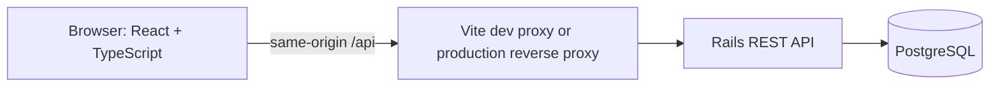
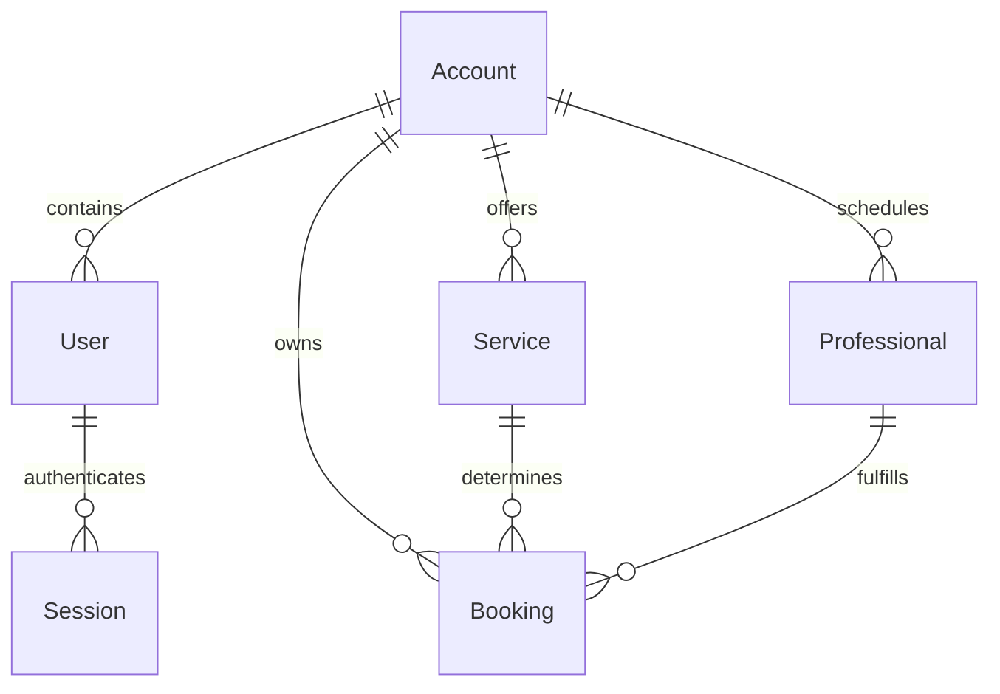

# Architecture and requirements

## Problem and audience

Small studios and independent service businesses need one internal place to manage customer appointments without assigning a professional to two customers at once. An internal booking tool is useful even without public scheduling or integrations.

## Functional requirements

1. An authenticated user belongs to one workspace and sees only its catalogs and appointments.
2. Owners create services and professionals. Staff can read catalogs and create/cancel/complete workspace bookings.
3. A booking references one service and one professional; both must belong to the current workspace.
4. The service determines the end time and price; these values are snapshots stored on the booking.
5. New bookings must be in the future and fit between 08:00 and 18:00 in the workspace's IANA zone, every day.
6. Active intervals for the same professional must not overlap. Cancelled bookings release the time. Adjacent intervals are allowed.
7. Only confirmed bookings can be cancelled or completed; completion is forbidden before the end time.
8. A date filter uses local day boundaries converted to UTC. Search/status/professional filtering applies to the fetched day on the frontend. Summary cards describe the full selected day, not only search results.
9. Lists include loading, error, empty and retry states. Forms remain open with error details when saving fails.

## Non-functional requirements

- PostgreSQL integrity: non-null fields, foreign keys, unique email/session-digest indexes, checks and an exclusion constraint.
- RSpec request tests cover permissions, invalid input, time rules, tenant isolation and session lifecycle.
- Playwright checks real browser/API interaction and a 390px viewport.
- Responsive Portuguese interface; English source identifiers, API messages and technical documentation.
- No secrets committed. Production requires explicit SECRET_KEY_BASE, an allowed APP_HOST and DATABASE_URL.
- No unmeasured performance or availability guarantee. The MVP is sized for small internal teams.

## Runtime



The frontend handles presentation, filters and form input. TanStack Query owns server state and invalidates booking/catalog caches after successful mutations. Rails authenticates each request and authorizes workspace actions. Active Record validations provide actionable messages; PostgreSQL is the final authority for overlapping schedules.

Controllers stay small. Domain rules live on Booking; an extra service layer would duplicate logic at this size. SOLID is applied where it reduces coupling rather than introducing empty abstractions. No background processing or microservices are needed.

## Data model



All primary keys are bigint IDs. Account stores an IANA time zone. Monetary values are integer BRL cents. Rails timestamps are persisted as UTC timestamp columns; local inputs are converted using Luxon and local day boundaries using ActiveSupport::TimeZone.

Booking stores customer name/email directly. A separate Customer model is deferred until customer history, merging and consent requirements exist. Service deletion/editing is outside this MVP; price and end-time snapshots preserve the booking's agreed values for future catalog editing.

## Double-booking invariant

```sql
EXCLUDE USING gist (
  professional_id WITH =,
  tsrange(starts_at, ends_at, '[)') WITH &&
) WHERE (status <> 'cancelled');
```

`[)` makes 09:00–10:00 and 10:00–11:00 compatible. Model validation checks existing records for useful feedback. It cannot serialize simultaneous inserts; the database constraint closes that race. PostgreSQL exclusion violations map to HTTP 409, whereas pre-existing conflicts discovered by validation return 422.

Booking status changes run inside `with_lock`, so a concurrent completion/cancellation rechecks the current row before applying a transition.

## Authentication and authorization

Passwords are hashed by BCrypt through has_secure_password. Login issues a 256-bit random bearer token; only its SHA-256 digest and expiry are persisted. Sessions expire in 12 hours. Logout deletes the current server-side session. The token is held in sessionStorage and sent in Authorization, never placed in URLs.

All resource queries start from current_account. Strong parameters prevent clients from setting account_id, price_cents, ends_at or initial status. Catalog creation checks the owner role on the server, regardless of UI visibility. API serializers explicitly list returned fields and never include password digests or session digests.

The workspace's staff role is an internal team role with access to all appointments in that workspace. It is not a customer account or a professional-specific permission model.

## Important tradeoffs

- Rate limiting uses process-local memory for a single-process MVP; shared storage belongs in a production deployment with multiple instances.
- Business hours are fixed. No claim of holiday, shift or daylight-saving edge-case coverage for arbitrary zones is made. The default São Paulo zone is covered by the exercised flows.
- Day lists are not paginated because the current UI asks for one day. Revisit indexing/pagination with measured usage.
- Native dialog supplies focus management, Escape dismissal and a modal backdrop; reduced motion is respected.
- Account scoping is application-level. Direct privileged database writes can bypass cross-workspace association checks; this is not database RLS.
- No external customer data or real payment information is used in the demo.
